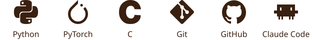
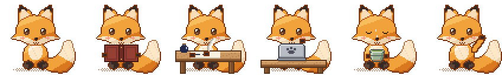

<a href="#meet-the-fox">
  <picture>
    <source media="(prefers-color-scheme: dark)" srcset="assets/hero-dark.svg">
    
  </picture>
</a>

Hi, I'm Tomoharu. I study vision-language models at Tokyo Metropolitan University.
In research and in the tools I build, what I enjoy is finding a clever way to solve a problem and the most beautiful design for its solution.

## Skills

<picture>
  <source media="(prefers-color-scheme: dark)" srcset="assets/skills-dark.svg">
  
</picture>

## Projects

- [**train4all**](https://github.com/tomoking2004/train4all) — a minimal PyTorch training framework. Subclass `BaseTrainer`, implement three methods, and get a complete training loop.
- [**claude-plugins**](https://github.com/tomoking2004/claude-plugins) — plugins for Claude and Claude Code, all finished to a single standard of beauty. Some of them polish code and documents until a check against that standard finds no defects.
- [**verba**](https://github.com/tomoking2004/verba) — a Windows desktop app that records any conversation you hear on your PC, from online meetings to lectures, and has Gemini transcribe and summarize it. Your voice and the other side's are kept on separate tracks, which help tell who said each line.

## Presentations

- Tomoharu Nakano and Daisuke Sugimura, "Effects of Task-Similarity-Based Internal Representation Alignment on the Outputs of Vision-Language Models," [PCSJ/IMPS 2026](https://www.pcsj-imps.org/archive/2026.html), poster P3-15, Nov. 2026.

## Competitions

- [32nd KOSEN Programming Contest](https://www.procon.gr.jp/archive/2021/) (2021), competition section — [4th in a semifinal match](https://www.gunma-ct.ac.jp/schoollife/event/procon/32_2021/), as "try"ple, a three-person team from Gunma College.

## Education

- **Tokyo Metropolitan University**, Graduate School of Systems Design, Department of Computer Science — master's program, Apr. 2026 – Mar. 2028 (expected).
- **Tokyo Metropolitan University**, Faculty of Systems Design, Department of Computer Science — bachelor's program, entered in the third year as a transfer student, Apr. 2024 – Mar. 2026.
- **National Institute of Technology (KOSEN), Gunma College**, Department of Information and Computer Engineering — five-year program, Apr. 2019 – Mar. 2024.

## Meet the fox

<p align="center">
  <a href="https://github.com/tomoking2004/claude-plugins">
    
  </a>
</p>

The foxes on this page come from **fox**, one of the plugins in [claude-plugins](https://github.com/tomoking2004/claude-plugins).
The plugin shows Claude at work as a pixel-art fox in a Claude Code panel.
The fox thinks, reads, writes, or types to match what Claude is doing, and waves when Claude needs your input.
When Claude hands work to subagents, each one appears beside the fox as a clone with a leaf on its forehead.
The fox sips tea while it waits for them.

To have the fox keep you company, run these in Claude Code:

```text
/plugin marketplace add tomoking2004/claude-plugins
/plugin install fox@tomoking2004
```
